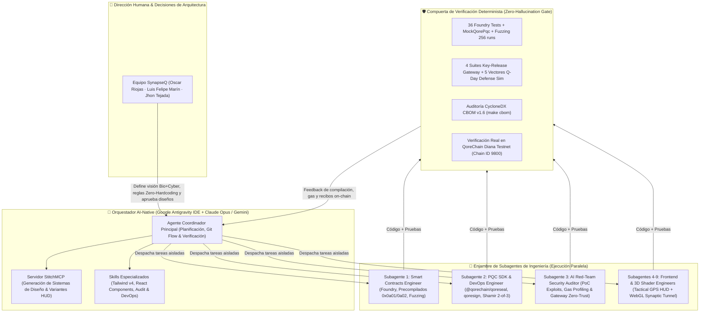
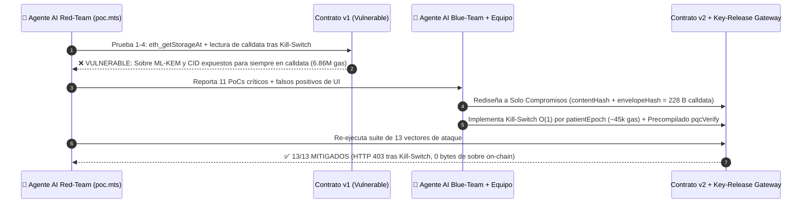

# 🤖🧬 `AI_USAGE.md` — Ingeniería AI-Native Multi-Agente en SynapseQ

[](https://build.qorechain.io/p/synapseq)
[](https://build.qorechain.io/es/projects)
[](./README.md)
[](./docs/informe-revision-key-release-gateway.md)
[](./.stitch/designs/)

> **"SynapseQ no utilizó la IA como un simple autocompletado de código: fue concebido, diseñado, auditado mediante ataques adversariales (Red-Teaming) y desplegado en QoreChain Diana Testnet a través de una arquitectura de ingeniería AI-Native orquestada con subagentes especializados, servidores MCP y verificación criptográfica determinista."**

---

## 1. Resumen Ejecutivo: ¿Por qué SynapseQ redefine el desarrollo AI-Native?

En el hackathon **QoreChain: Build Before Q-Day**, el mayor riesgo de usar Inteligencia Artificial en criptografía post-cuántica (`ML-KEM-1024`, `ML-DSA-87`) y contratos inteligentes (`Solidity 0.8.24`) es confiar ciegamente en código generado que parece funcional pero contiene vulnerabilidades críticas (como guardar secretos en variables `private` de la EVM, exponer sobres en el `calldata` o simular éxitos en el frontend cuando una transacción revierte).

En **SynapseQ**, adoptamos un paradigma **AI-Native con Verificación Formal y Red-Teaming Adversarial**:
1. **Orquestación Multi-Agente por Dominio (9 Subagentes Especializados):** Dividimos el sistema en agentes autónomos con roles aislados (*Smart Contracts Engineer*, *PQC SDK & DevOps Engineer*, *Frontend Architect*, *Tactical HUD UI Engineers*) coordinados por un agente principal.
2. **Diseño Generativo UI/UX conectado a Código vía MCP (`StitchMCP`):** Generamos y evaluamos 3 variantes arquitectónicas completas de interfaz hasta converger en el **Map-First Tactical HUD (Rebecca Glass Edition)** y la **Cinematic Landing v2** con shaders GLSL y túnel sináptico 3D.
3. **Auditoría Adversarial AI Red-Team vs. AI Blue-Team:** Un agente auditor independiente escribió un script de explotación (`poc.mts`) con **11 vectores de ataque reales** contra nuestra primera versión, descubriendo fugas en `calldata`, lectura de slots `private` con `eth_getStorageAt` y costos de gas de `6.86M`. El equipo y los agentes de ingeniería rediseñaron la arquitectura hacia el **Contrato v2 (Solo Compromisos) + Zero-Trust Key-Release Gateway**, mitigando **13/13 hallazgos** verificados con **36 tests en Foundry** y **4 suites de integración**.

---

## 2. Arquitectura del Pipeline de Desarrollo AI-Native



---

## 3. Herramientas AI-Native, Modelos y Servidores MCP Utilizados

| Herramienta / Motor IA | Rol en el Ciclo de Vida de SynapseQ | Impacto Medible en el Repositorio |
| :--- | :--- | :--- |
| **Google Antigravity (Agentic IDE) + Subagent Swarm** | Orquestación de 9 subagentes paralelos con acceso a terminal, compilador Foundry (`forge`, `anvil`, `cast`) y validación cruzada. | Aceleración de desarrollo modular en 4 paquetes (`contracts/`, `sdk/`, `gateway/`, `frontend/`) manteniendo 0 errores de tipado y formato. |
| **Claude Opus 4.6 / Sonnet 4.5 (Coding & Red-Team Agents)** | Auditoría adversarial de seguridad, integración con precompilados nativos de QoreChain (`0x...0a01` y `0x...0a02`), ventana EVM acotada y arquitectura del Key-Release Gateway. | Reducción de gas en registro HBOM de **6,860,918 gas a ~442,000 gas** local (`571,648` gas en Diana con `pqcVerify` real) y mitigación de **13/13 hallazgos de seguridad**. |
| **Stitch MCP (`StitchMCP` Server)** | Generación visual de sistemas de diseño y exploración de 3 arquitecturas minimalistas (*Floating Bio-Dock*, *Map-First Tactical HUD*, *Zen Clinical Bento*). | Exportación de diseños base y HTML/CSS en [`.stitch/designs/`](./.stitch/designs/) e implementación directa de la **Alternativa 2: Map-First Tactical HUD** con paleta *Rebecca Glass*. |
| **Asistencia en Shaders GLSL & Coreografía 3D** | Co-diseño matemático de shaders de vértices/fragmentos para el túnel neuronal 3D y transiciones con GSAP + Lenis. | Construcción de [`SynapticTunnelCanvas.tsx`](./frontend/src/landing/components/SynapticTunnelCanvas.tsx) y [`BlueprintIris.tsx`](./frontend/src/landing/components/BlueprintIris.tsx) en la **Cinematic Landing v2**. |
| **Skills de Agente (`tailwind-v4-shadcn`, `react:components`)** | Reglas de arquitectura en tiempo de ejecución para Tailwind CSS v4 (`@theme`), separación estricta de variables de entorno y validación de recibos Web3. | 100% cumplimiento de configuración por entorno ([`.env.example`](./.env.example)) y eliminación total de estados optimistas falsos en [`useSynapseVault.ts`](./frontend/src/hooks/useSynapseVault.ts). |

---

## 4. Casos de Estudio Reales: Cómo la IA resolvió problemas críticos en SynapseQ

### Caso 1: AI Red-Teaming — De una bóveda vulnerable a una arquitectura Zero-Trust de Compromisos
En la primera iteración del contrato inteligente, tanto el `ipfsCID` como el sobre post-cuántico `encryptedKeyEnvelope` se enviaban a `grantTimedAccess` y se guardaban en un mapping `private` de Solidity.
* **Hallazgo del Agente Red-Team ([`docs/informe-revision-key-release-gateway.md`](./docs/informe-revision-key-release-gateway.md)):** El agente auditor demostró con un script de ataque ejecutable que:
  1. Cualquier observador podía leer los slots `private` con `eth_getStorageAt` o extraer el sobre directamente del `calldata` histórico de la transacción.
  2. Incluso después de ejecutar el *Kill-Switch* (`emergencyRevokeAll`), un atacante podía seguir descifrando el expediente clínico desde el historial público de la blockchain.
  3. El bucle `for` en `emergencyRevokeAll()` era vulnerable a denegación de servicio por límite de gas de bloque ($O(n)$).
* **Solución AI-Native Implementada:**
  * Se rediseñó [`SynapseVaultRegistry.sol`](./contracts/src/SynapseVaultRegistry.sol) (v2) para almacenar **únicamente compromisos criptográficos** (`contentHash = SHAKE-256(ciphertext)` y `envelopeHash = keccak256(qoresealEnvelope)`), reduciendo el `calldata` de `grantTimedAccess` a solo **228 bytes**.
  * Se reemplazó el bucle de revocación por un contador de época por paciente (`patientEpoch`), convirtiendo `emergencyRevokeAll()` en una operación **$O(1)$ de ~45,000 gas** sin importar si el paciente tiene 1 o 10,000 pases.
  * Se construyó el **Zero-Trust Key-Release Gateway** ([`gateway/src/server.ts`](./gateway/src/server.ts)), que custodia el sobre `@qorechain/qoreseal` fuera de la cadena y solo lo libera tras verificar un reto firmado por la wallet del especialista en `Chain ID 9800` y confirmar en vivo que `isAccessValid(recordId) == true`.



---

### Caso 2: Integración con Precompilados Nativos PQC de QoreChain (`0x...0a01` / `0x...0a02`) y Simulación Local
Las firmas post-cuánticas **NIST FIPS 204 (`ML-DSA-87`)** miden `4,627 bytes`. Verificarlas en Solidity puro es inviable por costo de gas, pero QoreChain expone los precompilados nativos `pqcVerify` (`0x0000000000000000000000000000000000000a01`) y `pqcKeyStatus` (`0x0000000000000000000000000000000000000a02`).
* **Reto Técnico:** Al levantar un nodo local con Anvil (incluso haciendo `--fork-url https://evm-testnet.qore.host`), los precompilados nativos de QoreChain no existen en el binario estándar de Anvil y devuelven `0x`, haciendo que un contrato seguro que falla cerrado (`PqcUnavailable`) no pueda probarse localmente.
* **Solución AI-Native:**
  * Diseñamos [`SynapseVaultRegistry.sol`](./contracts/src/SynapseVaultRegistry.sol) para fallar cerrado en producción exigiendo que `pqcKeyStatus(msg.sender)` confirme una clave `ML-DSA-87` activa y que `pqcVerify` valide la firma sobre `firmwareAttestationMessage(partId, version, firmwareHash, calibrationHash)`.
  * Creamos [`MockQorePqc.sol`](./contracts/src/dev/MockQorePqc.sol) y el target `make dev-pqc-mock`, que inyecta con `anvil_setCode` el bytecode del mock en las direcciones exactas `0x...0a01` y `0x...0a02` del nodo local, mientras que la herramienta CLI del fabricante ([`sdk/src/oemCli.ts`](./sdk/src/oemCli.ts)) verifica criptográficamente la firma real `ML-DSA-87` derivada con `@qorechain/qoresign` antes de registrar la atestación.
  * Finalmente, verificamos la ejecución real en **QoreChain Diana Testnet (`Chain ID 9800`)** en la transacción [`0x427672fad7e92681e4debf88386946d598d1c96dc0c8a47f3d520bf7e0a1097f`](https://evm-testnet.qore.host) (`571,648` gas).

---

### Caso 3: Diseño UI/UX Generativo con Stitch MCP (`Map-First Tactical HUD`) + `Cinematic Landing v2`
Para evitar las interfaces genéricas generadas por IA, conectamos el servidor **`StitchMCP`** directamente al flujo de trabajo del agente:
1. **Generación de Sistema de Diseño:** Se definió en Stitch el proyecto `SynapseQ Tactical Bio-HUD` (`projects/519642423328785680`) con la paleta *Rebecca (Cyberpunk: Edgerunners)* (`#0B100E`, `#A8F0C6`, `#F4729B`, `#3B66E8`, `#FACC15`) y tipografías `Space Grotesk` + `JetBrains Mono`.
2. **Exploración de 3 Variantes Arquitectónicas:** Se generaron y exportaron a [`.stitch/designs/`](./.stitch/designs/) tres propuestas visuales completas (*Alt 1: Ultra-Clean Floating Bio-Dock*, *Alt 2: Map-First Tactical HUD*, *Alt 3: Zen Clinical Glass Bento*).
3. **Implementación Paralela con 3 Subagentes UI:** Tras seleccionar la **Alternativa 2: Map-First Tactical HUD**, tres subagentes especializados refactorizaron en paralelo [`PatientVaultView.tsx`](./frontend/src/components/patient/PatientVaultView.tsx), [`CyberHbomView.tsx`](./frontend/src/components/hbom/CyberHbomView.tsx) y [`SpecialistPortalView.tsx`](./frontend/src/components/specialist/SpecialistPortalView.tsx) sobre el lienzo vectorial [`TacticalGpsBackground.tsx`](./frontend/src/components/layout/TacticalGpsBackground.tsx), despejando el corredor central del mapa GPS y añadiendo el semáforo de ventana EVM acotada ([`EvmWindowBadge.tsx`](./frontend/src/components/layout/EvmWindowBadge.tsx)).

---

## 5. Gobernanza Humana, Reglas de Control y Prevención de Alucinaciones

El uso de IA en SynapseQ estuvo regido por **6 reglas inquebrantables de ingeniería humana**:

1. **Cero Secretos o Variables Hardcodeadas:** Todo endpoint RPC, dirección de contrato, puerto o credencial se inyecta por variables de entorno documentadas en [`.env.example`](./.env.example).
2. **Prohibición de Éxitos Simulados en Web3:** El hook [`useSynapseVault.ts`](./frontend/src/hooks/useSynapseVault.ts) ejecuta obligatoriamente:
   * Pre-chequeo de la **Ventana de Autorización EVM Acotada** (`allowedTargets` incluye `SynapseVaultRegistry`).
   * Simulación previa con `publicClient.simulateContract(...)` para decodificar errores personalizados del contrato antes de abrir la wallet.
   * Verificación estricta de `receipt.status === "success"` tras `waitForTransactionReceipt`.
3. **Distinción Explícita `ON-CHAIN` vs. `DEMO LOCAL`:** La interfaz etiqueta visualmente qué registros provienen de eventos y lecturas reales de QoreChain y cuáles son plantillas de demostración local.
4. **Control Humano de Versiones (`Human-in-the-Loop Git`):** Ningún agente tenía permiso para ejecutar `git commit` o `git push` de forma autónoma. Cada integración pasó por revisión humana de `git diff` y ejecución completa de `make test` antes de ser confirmada por el equipo.
5. **Pruebas de Tamaño Real Post-Cuántico:** Prohibimos el uso de firmas dummy de `16 bytes` en las pruebas de gas; los tests de Foundry ([`SynapseVaultRegistry.t.sol`](./contracts/test/SynapseVaultRegistry.t.sol)) validan llaves `ML-KEM-1024` de `1,568 bytes`, llaves híbridas QoreSeal de `1,720 bytes` y firmas `ML-DSA-87` completas de `4,627 bytes`.

---

## 6. Trazabilidad y Evidencia Verificable en el Repositorio

Cualquier juez o auditor puede verificar el trabajo generado y validado mediante nuestro flujo AI-Native directamente en este repositorio:

* 📋 **Auditoría Red-Team & Mitigación 13/13:** [`docs/informe-revision-key-release-gateway.md`](./docs/informe-revision-key-release-gateway.md)
* 🎨 **Artefactos y Pantallas Generadas con Stitch MCP:** [`.stitch/designs/`](./.stitch/designs/)
* 🛡️ **Simulador de 5 Vectores de Ataque Cuántico (Q-Day):** [`sdk/src/quantumDefenseSim.ts`](./sdk/src/quantumDefenseSim.ts) (`make test-quantum`)
* 📦 **Reporte CycloneDX CBOM v1.6:** [`cbom-report.json`](./cbom-report.json) (`make cbom`)
* ⛓️ **Suite de 36 Tests en Foundry (Precompilados PQC + Fuzzing):** [`contracts/test/SynapseVaultRegistry.t.sol`](./contracts/test/SynapseVaultRegistry.t.sol) (`make test-contracts`)
* 🔐 **Suite de 4 Pruebas de Integración del Key-Release Gateway & Ventana EVM:** [`gateway/src/test.ts`](./gateway/src/test.ts) (`make test-gateway`)

```bash
# Reproducir toda la verificación automatizada en un solo comando:
make test && make cbom
```
