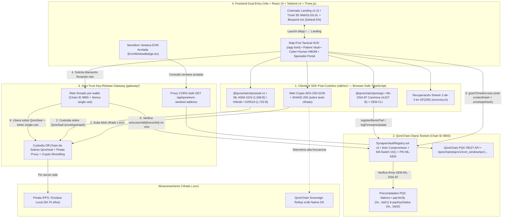
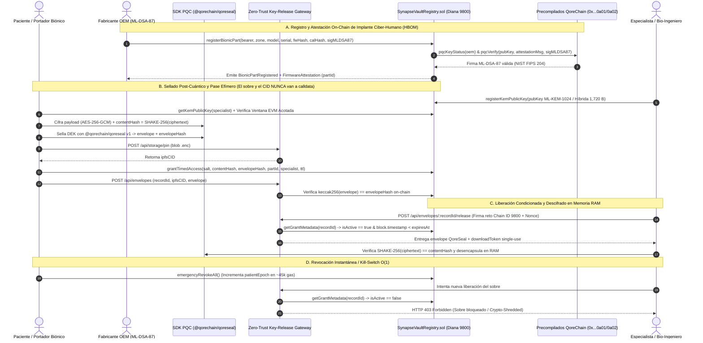
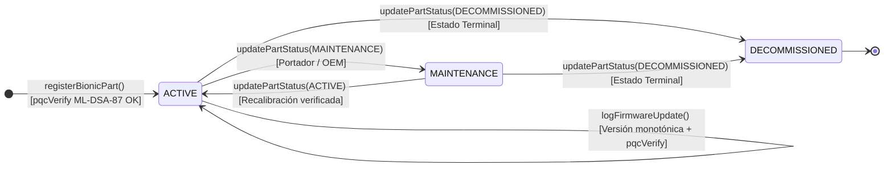

# 🧬⚙️ SynapseQ: Post-Quantum Ephemeral Health & Cyber-Human Augmentation Vault

[](https://build.qorechain.io/es/projects)
[-00D1B2?style=for-the-badge)](https://dashboard.qorechain.io/faucet)
[](https://build.qorechain.io/es/kits)
[](https://book.getfoundry.sh/)
[](./cbom-report.json)
[-A855F7?style=for-the-badge)](./AI_USAGE.md)
[](https://opensource.org/licenses/MIT)

> **"Protegiendo la biología humana del presente y asegurando la trazabilidad biónica de los ciber-humanos del mañana frente a la era cuántica."**

---

## 🌐 Visión Dual: De la Medicina Actual a la Era Ciber-Humana

**SynapseQ** nace como una bóveda descentralizada de datos biomédicos con resistencia post-cuántica y control de acceso efímero (*ephemeral access*). Sin embargo, su arquitectura está diseñada para trascender el expediente clínico tradicional y convertirse en el **estándar criptográfico de catalogación y trazabilidad de piezas biónicas, neuro-prótesis y órganos sintéticos para los futuros ciber-humanos**.

### 1. El Presente: Soberanía de Datos Clínicos e Imágenes Médicas
Los registros médicos actuales (estudios DICOM, resonancias magnéticas, perfiles genómicos e historiales clínicos) requieren una confidencialidad superior a **50-70 años**. A diferencia de una clave bancaria, tu ADN y tu historial médico no se pueden rotar ni revocar tras una filtración.
* **Defensa contra ataques *Harvest Now, Decrypt Later* (HNDL):** Los adversarios ya interceptan tráfico médico cifrado con algoritmos clásicos (RSA/ECC) esperando ordenadores cuánticos capaces de ejecutar el algoritmo de Shor.
* **Acceso Efímero Auto-Soberano:** Inspirado en la sinapsis neuronal, el paciente otorga pases temporales de lectura a médicos especialistas. Al expirar el contador o activarse la revocación manual (*Kill-Switch* $O(1)$), el contrato inteligente extingue el acceso de forma inmutable y el **Zero-Trust Key-Release Gateway** niega cualquier nueva liberación del sobre post-cuántico.

### 2. El Futuro: Catalogación y Trazabilidad de Piezas para Ciber-Humanos (HBOM)
A medida que la humanidad integra interfaces cerebro-computadora (BCI), extremidades biónicas, exoesqueletos, implantes cocleares/retinianos y órganos bio-impresos, **el cuerpo humano pasa a tener una Cadena de Suministro y una Lista de Materiales (*Human Bill of Materials* - HBOM)**.
* **Vulnerabilidad Cuántica en Cuerpo Humano:** Si un ordenador cuántico vulnera la firma criptográfica de un marcapasos, un brazo biónico o un implante neural, el riesgo deja de ser una filtración de privacidad y pasa a ser el **secuestro físico o alteración de una parte del cuerpo humano**.
* **Catalogación Universal de Piezas Humanas:** SynapseQ registra cada componente implantado como un activo único auditable on-chain: fabricante OEM (`partId = keccak256(fabricante, serial)`), zona anatómica, modelo, número de serie, versión monotónica de firmware, hash de calibración y firma **ML-DSA-87 (NIST FIPS 204)**.
* **Trazabilidad del Ciclo de Vida Biónico:** Desde el implante inicial, pasando por actualizaciones de firmware firmadas exclusivamente por el fabricante con `ML-DSA-87` y estados operativos (`ACTIVE`, `MAINTENANCE`, y estado terminal `DECOMMISSIONED`), hasta su reemplazo.
* **Pases Efímeros para Bio-Ingenieros:** Un ciber-humano puede otorgar acceso temporal (ej. 2 horas) ligado a una pieza `partId` específica para diagnosticar telemetría sin ceder control permanente de su hardware corporal.

---

## 🏗️ Arquitectura del Sistema (Contrato v2 + Key-Release Gateway + Map-First Tactical HUD)

SynapseQ combina cifrado post-cuántico en cliente (100% compatible con navegador), custodia Zero-Trust de sobres fuera de calldata público, almacenamiento descentralizado cifrado y gobernanza inmutable en **QoreChain Diana Testnet (`Chain ID 9800`)**:

### 1. Diagrama de Arquitectura Integrada (`flowchart`)



### 2. Flujo Criptográfico de Sellado, Custodia, Descifrado y Kill-Switch (`sequenceDiagram`)



### 3. Ciclo de Vida de Piezas Ciber-Humanas HBOM y Pases Efímeros (`stateDiagram-v2`)



> **Escalabilidad Institucional (Roadmap `x/rdk`):** El campo `contentHash` (`SHAKE-256`) del contrato y el módulo `sdk/src/rdkDa.ts` están diseñados para soportar tanto compromisos de integridad sobre **IPFS** (archivos médicos de 50-70 años) como futuros blobs efímeros en un **Sovereign Rollup (`x/rdk`, perfil `enterprise`)** de QoreChain con poda automática para telemetría biónica de alta frecuencia.

---

## 🎨 Interfaz Visual: Map-First Tactical HUD & Cinematic Landing v2 (Paleta Rebecca Glass)

El frontend (`frontend/`) ofrece una experiencia dual construida con **Vite + React 19 + Tailwind CSS v4 + Three.js**, inspirada en la paleta cromática *Rebecca (Cyberpunk: Edgerunners)* (`#0B100E` obsidiana verdosa, `#A8F0C6` menta pastel, `#F4729B` rosa coral, `#3B66E8` azul cobalto y `#FACC15` amarillo ácido):

* **Cinematic Landing v2 (`http://localhost:5173/` — `frontend/src/landing/`):** Página de llegada por defecto en **inglés (`EN`)** con selector bilingüe (`EN` / `ES`), túnel sináptico 3D en **Three.js + Shaders GLSL** (`SynapticTunnel.tsx`), iris de blueprint anatómico (`BlueprintIris.tsx`), coreografía de scroll con **GSAP ScrollTrigger + Lenis** y lanzamiento directo a cada módulo de la dApp (`/app.html?tab=...`).
* **Mapa Vectorial Táctico GPS en Tiempo Real (`http://localhost:5173/app.html` — `TacticalGpsBackground.tsx`):** Consola operativa con botón `← Landing` en la cabecera para regresar a la experiencia narrativa, curvas topográficas, cuadrícula urbana por sectores (`SECTOR-09 // WEST LATTICE`), anillos de radar concéntricos (`1.0 km` a `4.0 km`) y ruta vectorial conectando `ENCLAVE NODE [DIANA-9800]` con `PATIENT BEACON [#EQ-9042]`.
* **Riel HUD Flotante Izquierdo + Corredor Central Despejado + Drawer Inferior Derecho:** Las 3 vistas (*Patient Vault*, *Cyber-Human HBOM* y *Specialist Portal*) utilizan tarjetas de cristal translúcido (`backdrop-blur-md`) en los bordes para mantener el corredor central del mapa táctico 100% visible.
* **Semáforo de Ventana EVM Acotada (`EvmWindowBadge.tsx`) y Transparencia On-Chain:** La barra superior verifica en vivo la ventana de autorización PQC→EVM de la wallet conectada (*acotada al contrato*, *sin acotar* o *cerrada/agotada*), distingue explícitamente entre pases/implantes **ON-CHAIN** y **DEMO LOCAL**, simula cada transacción con `simulateContract` antes de firmar y comprueba `receipt.status === "success"`.

---

## 📁 Estructura del Repositorio

```text
SynapseQ/
├── Makefile                           # Automatización integral (build, init, down, test, lint, audit, cbom, deploy)
├── AI_USAGE.md                        # Documentación oficial de ingeniería AI-Native (Multi-Agent Swarm, Stitch MCP y AI Red-Team)
├── .env.example                       # Plantilla única de variables de entorno (sin secretos ni datos reales)
├── cbom-report.json                   # Reporte CycloneDX v1.6 Cryptography Bill of Materials (NIST Cat 5 PQC)
├── contracts/                         # Smart Contracts v2 (Foundry / Solidity 0.8.24)
│   ├── foundry.toml                   # Configuración EVM ("paris") y RPC Diana Testnet (9800)
│   ├── src/
│   │   ├── SynapseVaultRegistry.sol   # Contrato v2: Compromisos + Kill-Switch O(1) + HBOM pqcVerify + PKI ML-KEM
│   │   └── dev/MockQorePqc.sol        # Mock local de precompilados QoreChain (0x...0a01 / 0x...0a02) solo para Anvil
│   ├── test/
│   │   └── SynapseVaultRegistry.t.sol # 36 tests unitarios, precompilados PQC, regresiones, gas real y fuzzing
│   └── script/
│       └── DeploySynapseVault.s.sol   # Script de despliegue para nodo local o QoreChain Diana Testnet
├── gateway/                           # Zero-Trust Key-Release Gateway & Pinata Proxy (TypeScript / Node.js)
│   ├── src/
│   │   ├── server.ts                  # Custodia de sobres QoreSeal, proxy EVM window, cuotas, tokens y shredding
│   │   ├── auth.ts                    # Retos firmados por wallet ligados a Chain ID 9800 y nonces de un uso
│   │   ├── chain.ts                   # Verificación en vivo de getGrantMetadata / isAccessValid en QoreChain
│   │   ├── store.ts                   # Almacenamiento aislado de sobres y blobs cifrados
│   │   └── test.ts                    # 4 suites de pruebas (Shamir 2-de-3, release, límites y ventana EVM acotada)
├── sdk/                               # SDK Post-Cuántico Browser-Safe (@qorechain/qoreseal + qoresign + rdk + Viem)
│   ├── src/
│   │   ├── pqc.ts                     # @qorechain/qoreseal v1 (ML-KEM-1024 / híbrido +X25519), ML-DSA-87, SHAKE-256
│   │   ├── oem.ts                     # Lógica OEM de atestación de firmware ML-DSA-87 con deriveCanonicalPqKey
│   │   ├── oemCli.ts                  # CLI para fabricantes HBOM (status, register, update) en Diana o Anvil
│   │   ├── openEvmWindow.ts           # Apertura y consulta de ventana EVM acotada al contrato (MsgOpenEvmWindow)
│   │   ├── evmWindow.ts               # Verificación y clasificación de rechazos de ventana EVM (códigos pqc 26-28)
│   │   ├── qoreRest.ts                # Cliente REST de QoreChain (conversión 0x <-> bech32 qor1 y evm_window)
│   │   ├── recovery.ts                # Partición Shamir Secret Sharing 2-de-3 en GF(256) para llaves ML-KEM
│   │   ├── gatewayClient.ts           # Cliente tipado para autenticación, pin, custodia, release y evm-window
│   │   ├── storage.ts                 # Clientes cifrados Pinata IPFS y fallback local/enclave
│   │   ├── storageStrategy.ts         # SynapseStorageRouter (QoreChain DA vs Pinata IPFS vs Memory Fallback)
│   │   ├── rdkDa.ts                   # Integración con @qorechain/rdk (Sovereign Rollup & Native DA)
│   │   ├── quantumDefenseSim.ts       # Simulación ejecutable de 5 vectores de ataque post-cuántico (Q-Day)
│   │   ├── abi.ts                     # ABI tipado completo de SynapseVaultRegistry v2
│   │   └── demo.ts                    # Demo end-to-end de 7 pasos contra nodo local + Key-Release Gateway
├── frontend/                          # Frontend Dual-Entry: Cinematic Landing v2 (/) + Tactical Bio-HUD (/app.html)
│   ├── index.html                     # Entrypoint por defecto (/): Cinematic Landing v2 (EN default / ES switch)
│   ├── app.html                       # Entrypoint de la dApp (/app.html): Map-First Tactical Bio-HUD
│   ├── landing.html                   # Alias de compatibilidad hacia Cinematic Landing v2
│   ├── src/
│   │   ├── components/
│   │   │   ├── layout/                # TacticalGpsBackground + EvmWindowBadge (estado de ventana EVM acotada)
│   │   │   ├── patient/               # Vista 1: Portal Paciente & Bóveda Efímera (Tactical HUD)
│   │   │   ├── hbom/                  # Vista 2: Catálogo Ciber-Humano HBOM & Firmware ML-DSA-87 (Tactical HUD)
│   │   │   └── specialist/            # Vista 3: Portal Especialista & Decryption Drawer (Tactical HUD)
│   │   ├── landing/                   # Escenas GSAP/Lenis, SynapticTunnelCanvas (Three.js/GLSL), BlueprintIris, i18n
│   │   └── hooks/
│   │       └── useSynapseVault.ts     # Hook Web3 con pre-chequeo de ventana EVM, simulateContract y escaneo on-chain
├── .stitch/designs/                   # Diseños UI/UX y variantes minimalistas exportadas desde Stitch MCP
└── docs/
    ├── synapseq-plan-hackathon-v2.md  # Planificación estratégica del sprint
    └── informe-revision-key-release-gateway.md # Auditoría interna de seguridad e integraciones PQC en Diana
```

---

## 🛠️ Stack Tecnológico

### Smart Contracts & Blockchain (QoreChain)
* **Red Objetivo:** QoreChain Diana Testnet — EVM Lane (`Chain ID: 9800`, RPC: `https://evm-testnet.qore.host`).
* **Smart Contracts:** Solidity `0.8.24` compilado, probado y desplegado con **Foundry** (`forge`, `cast`, `anvil`).
* **Precompilados PQC Nativos & Seguridad On-Chain v2:** Verificación on-chain de firmas `ML-DSA-87` de fabricantes HBOM mediante los precompilados nativos de QoreChain `pqcKeyStatus` (`0x...0a02`) y `pqcVerify` (`0x...0a01`); solo hashes/compromisos on-chain (`contentHash` sobre texto cifrado y `envelopeHash`), `recordId = keccak256(patient, salt)`, `partId = keccak256(manufacturer, serial)`, `DECOMMISSIONED` terminal y `emergencyRevokeAll()` (*Kill-Switch* $O(1)$ por época en ~45k gas).

### Criptografía Post-Cuántica Oficial de QoreChain (100% Browser-Safe) & Recuperación
* **Sobres Post-Cuánticos (`@qorechain/qoreseal` v1):** Integración con la librería oficial **`@qorechain/qoreseal`** (**NIST FIPS 203 `ML-KEM-1024`** de `1,568 bytes` y soporte para modo híbrido **`ML-KEM-1024 + X25519`** de `1,720 bytes`), con derivación determinista firmada por la wallet del especialista (`deriveKemKeyPairFromSignature`) y retrocompatibilidad con sobres JSON previos.
* **Firmas Canónicas & Identidad PQC (`@qorechain/qoresign`):** Derivación canónica `deriveCanonicalPqKey` compatible con QoreX Wallet y firmas **NIST FIPS 204 (`ML-DSA-87`, `4,627 bytes`)** verificadas tanto en cliente como on-chain por el precompilado `0x...0a01`.
* **Ventana de Autorización EVM Acotada (`x/pqc`):** Apertura programática de ventanas EVM (`MsgOpenEvmWindow`) restringidas por `allowedTargets` exclusivamente a `SynapseVaultRegistry`, con límite de bloques y transacciones.
* **Recuperación de Emergencia:** **Shamir Secret Sharing 2-de-3** sobre $\text{GF}(256)$ (`sdk/src/recovery.ts`) para dividir la semilla de `ML-KEM-1024` entre Paciente, Custodio Clínico y Enclave Hardware.
* **Hashing & Cifrado Simétrico:** `@noble/hashes/sha3` (**SHAKE-256**, 32 bytes) y **Web Crypto API (`AES-256-GCM`)** acelerado por hardware.
* **Auditoría CBOM:** Reporte estándar **CycloneDX v1.6** ([cbom-report.json](cbom-report.json)) verificable con `make cbom`.

---

## 📜 Especificación de `SynapseVaultRegistry.sol` (Contrato v2)

### Módulo 1: Acceso Efímero Post-Cuántico (Solo Compromisos)
* `grantTimedAccess(salt, contentHash, envelopeHash, linkedPartId, specialist, domain, durationInSeconds) → recordId`: Emite un pase temporal guardando únicamente compromisos criptográficos (`228 bytes` de calldata; ~201k gas).
* `extendAccess(recordId, extraSeconds)`: Extiende un pase **activo** (no revive pases vencidos, revocados o apagados por Kill-Switch).
* `revokeAccess(recordId)`: Revoca instantáneamente un pase específico.
* `emergencyRevokeAll()`: **Kill-Switch** $O(1)$ que incrementa la época del paciente e invalida instantáneamente todos sus pases previos (~45k gas sin importar cuántos pases existan).
* `isAccessValid(recordId)` / `getGrantMetadata(recordId)` / `getGrantsBySpecialist(specialist)`: Consultadas por el Key-Release Gateway y por la bandeja on-chain del especialista.

### Módulo 2: Registro HBOM & Firmware Biónico
* `registerBionicPart(bearer, zone, modelName, serialNumber, firmwareHash, calibrationHash, pqcSignature) → partId`: Lo llama el fabricante (`msg.sender`); `partId = computePartId(fabricante, serial)`. Guarda `keccak256` de la firma `ML-DSA-87` y emite la firma completa en `FirmwareAttestation`.
* `logFirmwareUpdate(partId, newFirmwareHash, newCalibrationHash, pqcSignature)`: Parches de firmware (solo el fabricante).
* `updatePartStatus(partId, newStatus)`: Cambia el estado operativo; `DECOMMISSIONED` es terminal.
* **Verificación on-chain de la firma `ML-DSA-87` (`pqcVerify`):** `registerBionicPart` y `logFirmwareUpdate` obtienen la clave registrada del fabricante con el precompilado `pqcKeyStatus(msg.sender)` (`0x…0a02`) y verifican la firma con `pqcVerify` (`0x…0a01`). El mensaje firmado es `firmwareAttestationMessage(partId, version, firmwareHash, calibrationHash)`, ligado a chain ID, contrato, pieza y versión (no se puede reutilizar). Si el precompilado no responde (Anvil sin mock, mainnet), el contrato **falla cerrado** (`PqcUnavailable`). `requirePossessionProof` (constructor, `REQUIRE_PQC_POSSESSION`) exige además prueba de posesión de la clave.

#### Herramienta OEM (`sdk/src/oemCli.ts`)
La wallet web no puede firmar con ML-DSA, así que el fabricante firma con su **clave canónica** (la misma que registra QoreX, `deriveCanonicalPqKey`):
```bash
cd sdk
OEM_MNEMONIC="<mnemónico de testnet del fabricante>" QORECHAIN_RPC_URL=https://evm-testnet.qore.host \
SYNAPSE_VAULT_ADDRESS=<contrato> npm run oem -- status
OEM_MNEMONIC=… SYNAPSE_VAULT_ADDRESS=… npm run oem -- register --serial SN-1 --model "NeuroLink-X9" \
  --bearer 0x<portador> --zone 0 --firmware ./fw.bin --calibration "perfil-v1"
OEM_MNEMONIC=… SYNAPSE_VAULT_ADDRESS=… npm run oem -- update --part 0x<partId> --firmware ./fw-v2.bin
```
La cuenta del fabricante necesita en Diana su clave ML-DSA-87 registrada y una **ventana EVM abierta** (QoreX → Ajustes → Seguridad → Ventana de acceso EVM, o `npm run evm:open-window` acotada al contrato).

#### Pruebas locales y forks
Anvil (incluido `anvil --fork-url https://evm-testnet.qore.host`) **no ejecuta los precompilados nativos de QoreChain**: en un fork `pqcKeyStatus` devuelve `0x` y el contrato revierte con `PqcUnavailable`. Para desarrollo local, `make init` ejecuta `make dev-pqc-mock`, que coloca `MockQorePqc` (**solo dev**) en `0x…0a01/0a02`; la herramienta OEM verifica la firma ML-DSA-87 fuera de la cadena y aprueba en el mock solo esa terna exacta (clave, firma, mensaje). La verificación real solo ocurre en Diana; se comprobó por `eth_call` que el precompilado de Diana acepta las firmas de `pqSign` y rechaza un mensaje alterado.
* `getBionicPart(partId)` / `getPartsByBearer(bearer)` / `getFirmwareHistory(partId)`: Consultas completas del inventario corporal y su auditoría histórica.

### Módulo 3: Directorio On-Chain de Claves Públicas `ML-KEM-1024` (QoreChain PKI)
* `registerKemPublicKey(bytes calldata pubKey)`: Publica on-chain la clave pública `ML-KEM-1024` (`1,568 bytes` NIST FIPS 203) o la llave de destinatario híbrida QoreSeal (`1,720 bytes`, `ML-KEM-1024 + X25519`) del médico o bio-ingeniero.
* `getKemPublicKey(address account)` / `hasKemPublicKey(address account)`: Resuelve directamente desde QoreChain la llave pública post-cuántica de cualquier especialista antes de cifrar.

---

## ⚡ Automatización con `Makefile` (Instalación, Inicio, Detenido y Pruebas)

El proyecto cuenta con un [Makefile](Makefile) unificado que automatiza todo el ciclo de vida del stack (contratos Foundry, nodo local Anvil, Key-Release Gateway, SDK Post-Cuántico y Frontend Dual-Entry React + Tailwind v4).

### Tabla de Comandos `make`
Ejecuta `make` o `make help` en la raíz del repositorio para listar todos los comandos disponibles:

| Comando | Descripción |
| :--- | :--- |
| `make build` | ⚙️ **Primera vez:** instala `forge-std`, compila los contratos Solidity en Foundry, instala dependencias en `sdk/`, `gateway/` y `frontend/`, y verifica el build de producción (Bio-HUD + Cinematic Landing v2). |
| `make init` | 🚀 **Levantar el stack local:** inicia en background el nodo EVM **Anvil (`Chain ID 9800`)** en `:8545`, despliega `SynapseVaultRegistry.sol`, instala el mock PQC (`make dev-pqc-mock`), levanta el **Key-Release Gateway** en `:4000` y el **Frontend** en `:5173` (`/` Bio-HUD y `/landing.html` Landing v2). |
| `make down` | 🛑 **Detener el stack local:** finaliza únicamente los procesos lanzados por `make init` mediante sus archivos PID (`Anvil`, `Gateway` y `Frontend`). |
| `make test` | 🧪 **Suite completa acumulada:** ejecuta en orden `make lint` + `make test-contracts` + `make test-sdk` + `make test-gateway` + `make test-front`. |
| `make test-contracts` | ⛓️ Ejecuta los **36 tests unitarios**, precompilados PQC (`pqcVerify`/`pqcKeyStatus`), regresiones de seguridad, *timelocks* (`vm.warp`), *Kill-Switch* $O(1)$, HBOM, PKI y *fuzzing* en Foundry (`forge test -vvv`). |
| `make test-gateway` | 🛡️ Ejecuta las **4 suites de pruebas del Key-Release Gateway** (Shamir 2-de-3, custodia/liberación condicionada, tokens de descarga, cuotas, CORS, *crypto-shredding* y proxy de ventana EVM acotada). |
| `make test-sdk` | 🔐 Valida tipado (`tsc --noEmit`), linting (`eslint`) y ejecuta la simulación de 5 vectores de defensa post-cuántica (`@qorechain/qoreseal` v1 + `ML-DSA-87`). |
| `make test-quantum` | 🛡️ Ejecuta `sdk/src/quantumDefenseSim.ts` probando los 5 vectores de ataque Q-Day (HNDL, Tampering de 1 bit, SHAKE-256 mismatch, falsificación `ML-DSA-87` y `SynapseStorageRouter`). |
| `make cbom` | 📋 Audita y valida el reporte **CycloneDX CBOM v1.6** ([cbom-report.json](cbom-report.json)). |
| `make test-front` | ⚛️ Valida el tipado estricto y la compilación de producción (`vite build`) de ambos entrypoints (`index.html` y `landing.html`). |
| `make lint` | 🔍 Verificación de formato y tipos en todo el monorepo (`forge fmt --check` + `eslint` + `tsc` en `sdk`, `gateway` y `frontend`). |
| `make audit` | 🛡️ Auditoría de seguridad de dependencias (`npm audit`) en `sdk/`, `gateway/` y `frontend/`. |
| `make demo` | 🎯 Ejecuta la demo end-to-end post-cuántica de 7 pasos (`sdk/src/demo.ts`) contra el nodo local y el Key-Release Gateway activos. |
| `make dev-pqc-mock` | 🧪 Instala `MockQorePqc` en `0x...0a01` y `0x...0a02` sobre Anvil local y registra la clave `ML-DSA-87` de desarrollo del fabricante OEM. |
| `make oem-status` | 🦾 Consulta el estado on-chain de la clave `ML-DSA-87` del fabricante OEM y de los precompilados PQC (`sdk/src/oemCli.ts`). |
| `make deploy-local` | 📦 Despliega `SynapseVaultRegistry.sol` en el nodo Anvil local (`:8545`). |
| `make deploy-diana` | 🌐 Despliega `SynapseVaultRegistry.sol` en **QoreChain Diana Testnet real (`Chain ID 9800`)** usando las variables de `.env`. |
| `make clean` | 🗑️ Detiene el stack activo y limpia artefactos de compilación, cachés, PIDs y logs temporales (`/tmp/synapseq-*`). |

### Flujo Rápido Recomendado con `make`
```bash
# 1. Clonar el repositorio y crear el archivo .env (opcional para desarrollo local)
git clone https://github.com/Oriojas/SynapseQ.git
cd SynapseQ
cp .env.example .env

# 2. Instalar dependencias y compilar los 4 módulos (primera vez)
make build

# 3. Levantar todo el entorno local (Anvil :8545 + Deploy Contrato + Mock PQC + Gateway :4000 + Frontend :5173)
make init

# 4. Ejecutar la demo criptográfica de 7 pasos contra el stack local activo
make demo

# 5. Ejecutar la suite completa de calidad, 36 tests Foundry, 4 suites Gateway, Simulación Q-Day y CBOM
make test
make cbom

# 6. Detener los servicios de SynapseQ
make down
```

---

## 🔧 Ejecución Manual Paso a Paso y Despliegue en Diana Testnet

### 1. Clonar e instalar dependencias de Smart Contracts (Foundry)
```bash
git clone https://github.com/Oriojas/SynapseQ.git
cd SynapseQ/contracts

# Instalar forge-std (si es la primera vez tras clonar)
forge install foundry-rs/forge-std --no-git

# Ejecutar los 36 tests (precompilados PQC, timelocks con vm.warp, Kill-Switch, HBOM y fuzzing)
forge test -vvv
```

### 2. Levantar un Nodo Local Anvil (`Chain ID 9800`) e Instalar Mock PQC
En una terminal:
```bash
anvil --chain-id 9800 --port 8545 --host 127.0.0.1
```

### 3. Desplegar el contrato e instalar el Mock PQC en el Nodo Local
En otra terminal:
```bash
cd SynapseQ
make deploy-local
make dev-pqc-mock
```

### 4. Ejecutar la Demo End-to-End Post-Cuántica (Cifrado QoreSeal Real + Gateway + QoreChain)
```bash
cd sdk
npm install

# Opcional: pasar la dirección impresa en el paso anterior si cambia
SYNAPSE_VAULT_ADDRESS="<DIRECCION_DESPLEGADA>" npm run demo
```
La demo ejecuta automáticamente los 7 pasos reales: generación y publicación on-chain de llaves `ML-KEM-1024` y `ML-DSA-87` → firma canónica OEM y registro de implante BCI en HBOM verificado por `pqcVerify` → cifrado `AES-256-GCM` + sellado `@qorechain/qoreseal` v1 (`ML-KEM-1024`) → custodia en Key-Release Gateway y pase efímero on-chain → liberación autenticada, descifrado en memoria y verificación `SHAKE-256` → **Kill-Switch** $O(1)$ y bloqueo `HTTP 403` en el Gateway.

### 5. Despliegue a QoreChain Diana Testnet Real (`Chain ID 9800`)
```bash
cd sdk
# 1. Ventana SIN acotar, solo para desplegar (una ventana con allowedTargets rechaza crear contratos)
DEPLOYER_MNEMONIC="<TU_RECOVERY_PHRASE_DE_TESTNET>" EVM_WINDOW_ALLOWED_TARGETS=any \
  EVM_WINDOW_BLOCKS=200 EVM_WINDOW_MAX_TXS=3 npm run evm:open-window

# 2. Desplegar el contrato en Diana Testnet
cd .. && make deploy-diana && cd sdk

# 3. Ventana ACOTADA al contrato para operar la dApp ("ventana EVM acotada")
DEPLOYER_MNEMONIC="…" SYNAPSE_VAULT_ADDRESS=0x<contrato> npm run evm:open-window

# Consultar la ventana (solo lectura, sin transacción)
DEPLOYER_MNEMONIC="…" npm run evm:window-status
```

#### Ventana EVM acotada en la dApp
QoreChain solo admite transacciones EVM de cuentas con clave ML-DSA-87 registrada **y** una ventana de autorización abierta (límite de bloques, transacciones y valor). SynapseQ la trata como parte de su modelo de seguridad:
* **Apertura acotada por defecto:** `npm run evm:open-window` restringe la ventana (`allowedTargets`) al contrato `SYNAPSE_VAULT_ADDRESS`. Si la clave clásica secp256k1 se viera comprometida, solo podría llamar a `SynapseVaultRegistry`, dentro de los límites de la ventana. `EVM_WINDOW_ALLOWED_TARGETS=any` la abre sin acotar y debe usarse solo para desplegar.
* **Estado visible en la interfaz:** el gateway consulta `GET /qorechain/pqc/v1/evm_window/{qor1…}` (la API REST de QoreChain no tiene CORS) en `GET /api/qore/evm-window/{0x…}`, con caché de 10 s. La cabecera muestra *acotada* (verde), *SIN ACOTAR* (ámbar) o *sin ventana / agotada / fuera de alcance* (rojo).
* **Bloqueo previo:** antes de pedir la firma, la dApp comprueba que la ventana admite una llamada al contrato y, si no, explica cómo abrirla en lugar de enviar una transacción que el nodo rechazaría.
* **Rechazos traducidos:** los errores del nodo (*no registered post-quantum key*, *no open EVM authorisation window*, ventana agotada, límites inválidos; códigos `pqc` 26/27/28) se muestran con su solución, con las mismas reglas que `classifyEvmWindowRejection` de `@qorechain/sdk`.
* En un Anvil local no existen ventanas: el gateway informa `enforced: false` salvo que se defina `QORECHAIN_REST_URL`.

---

## 🌐 Despliegue Verificado en QoreChain Diana Testnet (`Chain ID 9800`)

| Recurso | Valor Verificado On-Chain |
| :--- | :--- |
| **Red / RPC** | QoreChain Diana Testnet (`Chain ID 9800`) · `https://evm-testnet.qore.host` |
| **Contrato `SynapseVaultRegistry`** | `0x0f6c2bbbb4137e7809669C05b075616556A2c2d6` |
| **Tx de verificación HBOM `pqcVerify` (`ML-DSA-87`, 4,627 B)** | `0x427672fad7e92681e4debf88386946d598d1c96dc0c8a47f3d520bf7e0a1097f` (`571,648` gas) |
| **Pieza HBOM registrada (`DIANA-BCI-001`)** | `0x9dbc0f0a3521487e0665848ff4bacf1934888f10f479869d6f617858fbb58c8c` |

---

## 👥 Equipo de Desarrollo

| Integrante | GitHub | Rol Principal | Enfoque en SynapseQ |
| :--- | :--- | :--- | :--- |
| **Oscar Riojas** | [@Oriojas](https://github.com/Oriojas) | **Tech Lead, PQC Cryptography, Storage & UI/UX** | Criptografía `ML-KEM-1024` / `ML-DSA-87`, integración con IPFS, diseño UI/UX en Stitch MCP (*Map-First Tactical HUD — Rebecca Glass*), automatización `Makefile` y reporte CycloneDX CBOM (`cbom-report.json`). |
| **Luis Felipe Marín** | [@LuisFelipe09](https://github.com/LuisFelipe09) | **Smart Contracts, PQC Security & Blockchain Engineer** | Arquitectura de `SynapseVaultRegistry.sol` v2 (Compromisos + HBOM con precompilados `pqcVerify` + Kill-Switch $O(1)$ + PKI) en **Foundry** (36 tests), **Zero-Trust Key-Release Gateway**, integración `@qorechain/qoreseal` + `@qorechain/qoresign`, ventana EVM acotada y despliegue en Diana Testnet. |
| **Jhon Tejada** | [@tejada95](https://github.com/tejada95) | **Frontend, 3D Creative & Backend Integration** | **Cinematic Landing v2** (Three.js + Shaders GLSL + GSAP/Lenis + Blueprint Iris), componentes interactivos del Portal Paciente/Ciber-Humano y Portal Especialista, experiencia de usuario y flujos Web3. |

---

## 🔗 Enlaces del Ecosistema QoreChain

* **Hackathon Build Before Q-Day:** https://build.qorechain.io/es/projects
* **Documentación Oficial QoreChain:** https://docs.qorechain.io/es/introduction
* **RPC Oficial Diana Testnet (Chain ID 9800):** `https://evm-testnet.qore.host`
* **Faucet Oficial Diana Testnet:** https://dashboard.qorechain.io/faucet

---

## 📄 Licencia

Distribuido bajo la licencia **MIT**. Consulta el archivo [LICENSE](LICENSE) para más información.
